# Deep-Level Architecture Document: Stash Personal Finance Tracker

## 1. Directory Tree & File Inventory

Stash is an offline-first, high-performance personal finance and debt tracker engineered in Kotlin with Jetpack Compose. The architecture conforms to modern Android engineering principles: Unidirectional Data Flow (UDF), Room Object-Relational Mapping with strict non-destructive migrations, Jetpack DataStore Preferences, 120Hz LTPO display synchronization, biometric hardware authentication, and dynamic Material Design 3 (Monet) theming.

```
Stash/
├── build.gradle.kts                      # Root Gradle build script (AGP 8.7.2, Kotlin 2.0.21, KSP 2.0.21-1.0.28)
├── settings.gradle.kts                   # Project configuration and Maven repository declarations
├── gradle.properties                     # JVM arguments, AndroidX flags, AAPT2 override
├── gradlew / gradlew.bat                 # Unix/Windows Gradle Wrapper execution entry points
├── gradle/wrapper/
│   ├── gradle-wrapper.properties         # Gradle distribution configuration (v8.11)
│   └── gradle-wrapper.jar                # Gradle wrapper execution jar
└── app/
    ├── build.gradle.kts                  # App build configuration (minSdk 31, targetSdk 35, compileSdk 35, Room schemas)
    ├── proguard-rules.pro                # R8 shrinking & keep rules for Room, Coroutines, Serialization
    ├── schemas/                          # Room exported JSON schemas for migration verification
    │   └── com.nan.stash.data.local.AppDatabase/
    │       ├── 1.json                    # Schema v1 (initial ledger without note or paymentMode)
    │       ├── 2.json                    # Schema v2 (added note column)
    │       ├── 3.json                    # Schema v3 (added paymentMode column)
    │       └── 4.json                    # Schema v4 (added loans table with borrower info, balances, due dates)
    └── src/
        ├── androidTest/
        │   └── java/com/nan/stash/
        │       └── MigrationTest.kt      # Room MigrationTestHelper verifying v1->v2, v2->v3, v3->v4, and v1->v4
        └── main/
            ├── AndroidManifest.xml       # App declaration, hardware acceleration, permissions, FileProvider
            ├── res/
            │   ├── drawable/             # XML vector assets and launcher bitmaps
            │   ├── mipmap-*/             # Multi-density legacy launcher icons
            │   ├── values/               # Strings, colors, XML themes
            │   └── xml/
            │       └── file_paths.xml    # FileProvider content mapping for CSV/JSON export
            └── java/com/nan/stash/
                ├── MainActivity.kt       # Root Activity: 120Hz display pinning, biometric gate, FAB & Modal orchestration
                ├── data/
                │   ├── model/
                │   │   ├── TransactionType.kt  # Discriminator enum (INCOME, EXPENSE, TRANSFER, LEND, REPAYMENT)
                │   │   └── PaymentMode.kt      # Wallet channel enum (ONLINE, CASH)
                │   └── local/
                │       ├── TransactionEntity.kt # Room SQL entity for financial transactions
                │       ├── TransactionDao.kt    # Reactive Room Data Access Object (Flow queries, insert, update, delete)
                │       ├── LoanEntity.kt        # Room SQL entity for tracked loans (borrower, phone, balance, dates, status)
                │       ├── LoanDao.kt           # Room Data Access Object for loans (Flow queries, insert, update, delete)
                │       ├── AppDatabase.kt       # RoomDatabase definition (exportSchema=true, non-destructive migrations 1->4)
                │       └── SettingsDataStore.kt # Proto-like Preferences DataStore for themes, currency, and biometric locks
                └── ui/
                    ├── MainViewModel.kt         # AndroidViewModel: StateFlow orchestration, transfers, loans, edits, backups
                    ├── navigation/
                    │   ├── NavRoutes.kt         # Sealed class Screen hierarchy (Home, History, Tags, Settings)
                    │   └── BottomNavBar.kt      # Material 3 NavigationBar component
                    ├── components/
                    │   ├── CommonComponents.kt  # Reusable UI primitives: CategoryIcon, Dynamic Color mapping
                    │   └── StashLogo.kt         # Procedural reactive Material 3 vector logo component
                    ├── screens/
                    │   ├── HomeScreen.kt        # Primary dashboard: dual-wallet balance, lent money banner, weekly graph, recent feed
                    │   ├── HistoryScreen.kt     # Filterable transaction ledger (search, chips including Lent, clickable for edit)
                    │   ├── TagsScreen.kt        # Category analytics: ranked spending cards, percentage shares, month comparisons
                    │   ├── SettingsScreen.kt    # Preferences: Theme, currency, biometric toggle, CSV/JSON backup
                    │   ├── AddMoneyBottomSheet.kt      # Native mobile keyboard decimal input modal for income logging
                    │   ├── SpendMoneyBottomSheet.kt    # Native mobile keyboard decimal input modal for expense logging
                    │   ├── TransferMoneyBottomSheet.kt # Native mobile keyboard transfer modal (Online ⇄ Cash)
                    │   ├── EditTransactionBottomSheet.kt # Full-feature transaction editor with decimal keyboard
                    │   ├── LendMoneyBottomSheet.kt     # Lending entry modal: person name, contact, reason, quick due dates, wallet source
                    │   └── LentMoneyManagerSheet.kt    # Full loan management: overview, filter chips, direct Call/WhatsApp triggers, repayments
                    ├── util/
                    │   └── DateUtils.kt         # Zero-allocation thread-safe DateTimeFormatter singleton for 120Hz scrolling
                    └── theme/
                        ├── Color.kt             # Legacy fallback color definitions
                        ├── Shape.kt             # Material 3 rounded corner shape tokens
                        ├── Type.kt              # Material 3 typography definitions
                        └── Theme.kt             # Dynamic Material You color scheme provider (API 31-35)
```

---

## 2. Diagram 1: System Context

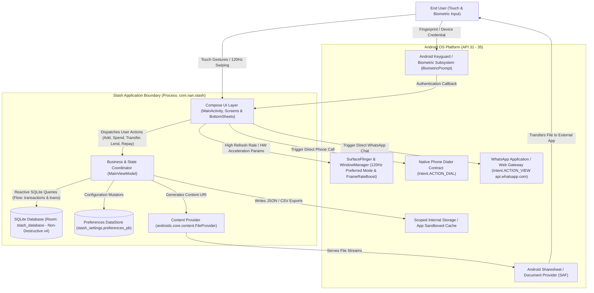

### Explanation
- **Purpose**: Defines the operational boundary of Stash, showing how the application interfaces with external Android OS subsystems (Biometrics, WindowManager, Scoped Storage, Native Dialer, and WhatsApp) without relying on any external remote cloud servers or proprietary third-party SDKs.
- **Key Files**: `MainActivity.kt`, `AndroidManifest.xml`, `file_paths.xml`.
- **Patterns Used**: Intent-based external service integration, ContentProvider delegation, Hardware abstraction.

---

## 3. Diagram 2: High-Level Layers & Architecture Modules

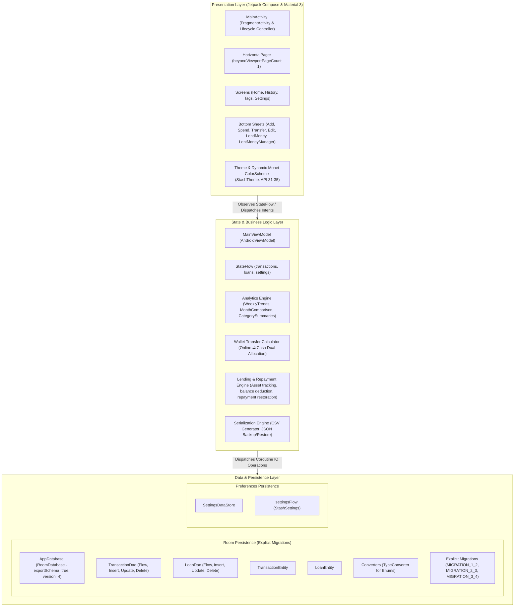

### Explanation
- **Purpose**: Establishes strict separation of concerns into Presentation, Domain/State, and Data Persistence layers.
- **Key Files**: `MainActivity.kt`, `MainViewModel.kt`, `AppDatabase.kt`, `TransactionDao.kt`, `LoanDao.kt`, `SettingsDataStore.kt`.
- **Patterns Used**: Clean Architecture separation, Unidirectional Data Flow (UDF), Repository-less Direct DAO Binding (ideal for embedded Android performance), Offline-First persistence.

---

## 4. Diagram 3: Module & Package Dependency Graph (Imports)

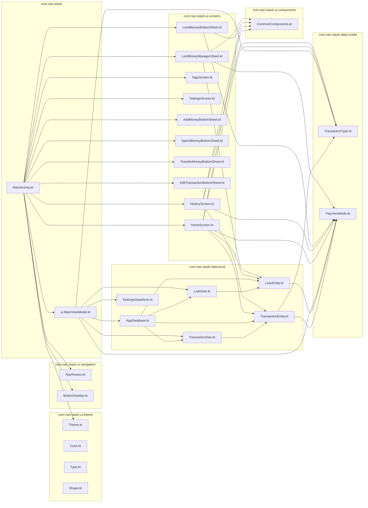

### Explanation
- **Purpose**: Illustrates compile-time coupling and circular dependency avoidance across packages. Models and entities reside at the lowest dependency tier, consumed upwards by DAOs, ViewModel, Screens, and the root Activity.
- **Key Files**: Entire `com.nan.stash.*` package structure.
- **Patterns Used**: Acyclic Dependency Principle (ADP), Layered Inversion.

---

## 5. Diagram 4: Key End-to-End User Flow Sequences

### 5.1 Wallet Transfer Flow (Online ⇄ Cash Without Distortion)

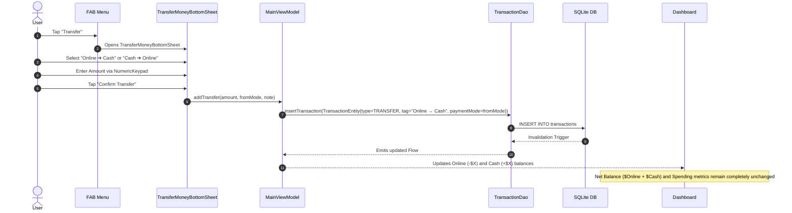

### 5.2 Interactive Transaction Editing & Deletion Flow

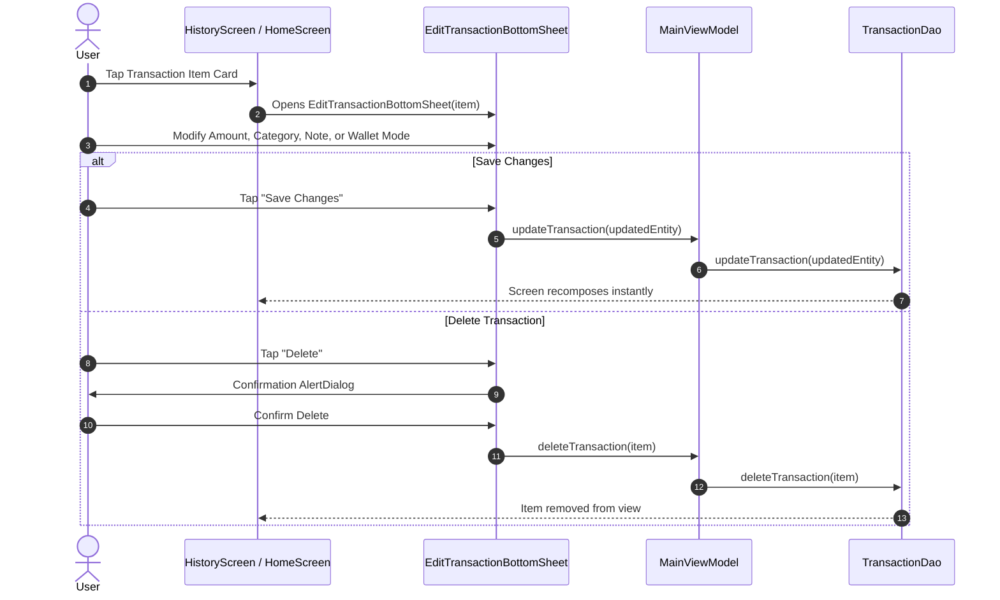

### 5.3 Lending Money, Contact Calling & WhatsApp Action Flow

```mermaid
sequenceDiagram
    autonumber
    actor User
    participant FAB as FAB Menu
    participant LendSheet as LendMoneyBottomSheet
    participant Manager as LentMoneyManagerSheet
    participant AndroidSystem as Android OS (Dialer & WhatsApp)
    participant VM as MainViewModel
    participant Room as Room Database

    User->>FAB: Tap "Lend Money"
    FAB->>LendSheet: Opens LendMoneyBottomSheet
    User->>LendSheet: Enter Borrower Name, Phone, Amount, Reason, Due Date, Mode (Cash)
    User->>LendSheet: Tap "Confirm & Record Loan"
    LendSheet->>VM: lendMoney(...)
    VM->>Room: INSERT INTO loans & INSERT INTO transactions (type=LEND, mode=CASH)
    Room-->>VM: Invalidation Tracker
    Note over VM: Cash wallet decreases by loan amount; Owed asset balance increases.
    
    User->>Manager: Tap "Money Lent" Card on Dashboard
    Manager->>User: Displays active borrowers with progress, status, and communication triggers
    alt Direct Phone Call
        User->>Manager: Tap Call Button
        Manager->>AndroidSystem: Intent(ACTION_DIAL, "tel:<clean_number>")
        AndroidSystem-->>User: Opens Native Phone Dialer
    else Direct WhatsApp Chat
        User->>Manager: Tap WhatsApp Button
        Manager->>AndroidSystem: Intent(ACTION_VIEW, "https://api.whatsapp.com/send?phone=...&text=...")
        AndroidSystem-->>User: Opens WhatsApp conversation with customized reminder
    else Partial or Full Repayment
        User->>Manager: Tap "Repay" -> Enter Amount received in Online
        Manager->>VM: recordRepayment(loan, amount, ONLINE, note)
        VM->>Room: UPDATE loans (balance reduced) & INSERT INTO transactions (type=REPAYMENT, mode=ONLINE)
        Note over VM: Online wallet increases; Loan marked settled when balance hits 0.
    end
```

---

## 6. Diagram 5: Entity-Relationship & Persistence Data Model

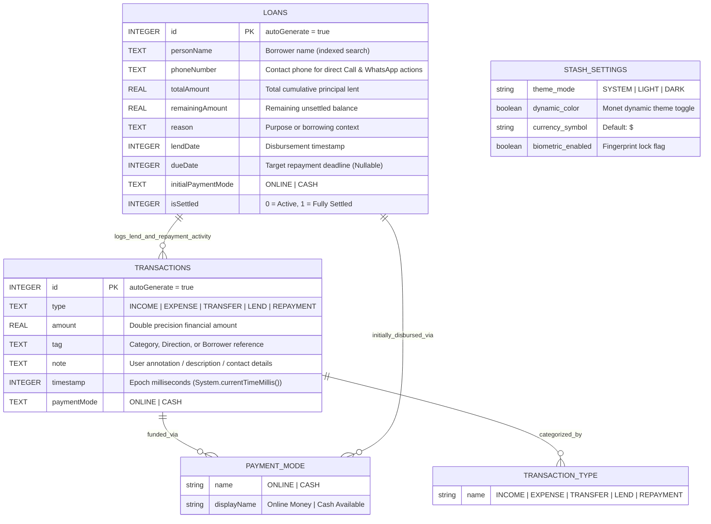

### Explanation
- **Purpose**: Defines SQLite physical schema (Room) and preferences store structure.
- **Key Files**: `TransactionEntity.kt`, `LoanEntity.kt`, `TransactionType.kt`, `PaymentMode.kt`, `SettingsDataStore.kt`.
- **Patterns Used**: Typed SQLite Entities with TypeConverters, Normalized tables, Explicit non-destructive schema migrations (v1 $\rightarrow$ v4).

---

## 7. Diagram 6: Internal API & Navigation Route Map

```mermaid
graph TD
    subgraph NavigationRoutes["Client Navigation Routes (HorizontalPager: beyondViewportPageCount=1)"]
        R0["Route: 'home' (Page 0) -> HomeScreen"]
        R1["Route: 'history' (Page 1) -> HistoryScreen"]
        R2["Route: 'tags' (Page 2) -> TagsScreen"]
        R3["Route: 'settings' (Page 3) -> SettingsScreen"]
    end

    subgraph ViewModelActions["MainViewModel Command Interface (MVI / UDF)"]
        A1["addTransaction(type, amount, tag, note, timestamp, mode)"]
        A2["addTransfer(amount, fromMode, note, timestamp)"]
        A3["lendMoney(person, phone, amount, reason, dueDate, mode, lendDate)"]
        A4["recordRepayment(loan, amountRepaid, mode, note)"]
        A5["addMoreToLoan(loan, additionalAmount, mode, note)"]
        A6["deleteLoan(loan)"]
        A7["updateTransaction(transaction)"]
        A8["deleteTransaction(transaction)"]
        A9["clearAllData()"]
        A10["exportToCsv(transactions): File"]
        A11["createBackupJson(transactions): File"]
        A12["restoreFromJson(jsonString, callback)"]
        A13["setThemeMode / setCurrencySymbol / setBiometricEnabled"]
    end

    subgraph SystemContracts["System Intent & Content Provider Endpoints"]
        I1["ACTION_DIAL -> tel:number"]
        I2["ACTION_VIEW -> https://api.whatsapp.com/send?phone=...&text=..."]
        I3["ACTION_SEND -> FileProvider content://com.nan.stash.provider/... (CSV / JSON)"]
        I4["ACTION_GET_CONTENT -> */* (SAF Document Picker for JSON Restore)"]
    end

    R0 -->|"Dashboard Actions"| A1
    R0 -->|"Dashboard Actions"| A2
    R0 -->|"Borrower Management"| A3
    R0 -->|"Repayments"| A4
    R1 -->|"Ledger Operations"| A7
    R1 -->|"Ledger Operations"| A8
    R3 -->|"Preferences"| A10
    R3 -->|"Preferences"| A11
    R3 -->|"Preferences"| A12
    R3 -->|"Preferences"| A13
    A3 --> I1
    A3 --> I2
    A10 --> I3
    A11 --> I3
    A12 --> I4
```

### Explanation
- **Purpose**: Maps application navigation destinations, ViewModel public action handlers, and system-level IPC intent contracts.
- **Key Files**: `NavRoutes.kt`, `BottomNavBar.kt`, `MainViewModel.kt`, `MainActivity.kt`.
- **Patterns Used**: MVI intent dispatching, SAF intent contracts, URI grant sharing via FileProvider.

---

## 8. Diagram 7: State Management & Reactive Data Flow (UDF)

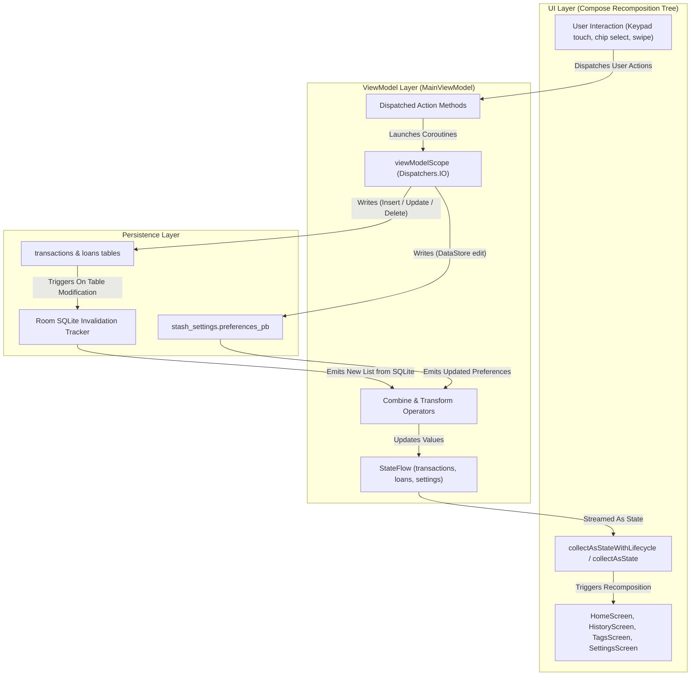

### Explanation
- **Purpose**: Visualizes the single source of truth reactive pipeline. The UI never mutates state directly; it issues intents to the ViewModel, which executes SQLite transactions on `Dispatchers.IO`. Room's invalidation tracker automatically re-emits updated data into `StateFlow`, driving atomic UI recompositions.
- **Key Files**: `MainViewModel.kt`, `TransactionDao.kt`, `LoanDao.kt`, `HomeScreen.kt`.
- **Patterns Used**: Unidirectional Data Flow (UDF), Observer Pattern via Kotlin Coroutines `Flow`, Reactive SQLite.

---

## 9. Diagram 8: Authentication & Security Flow (Biometric Lock)

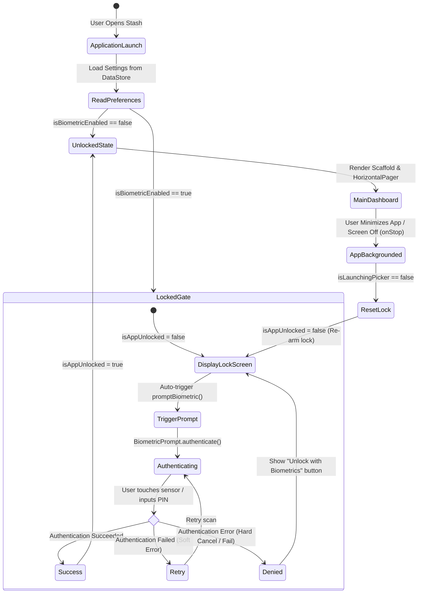

### Explanation
- **Purpose**: Explains how biometric security protects sensitive financial records during app launch and resume cycles.
- **Key Files**: `MainActivity.kt`, `SettingsDataStore.kt`.
- **Patterns Used**: Activity Lifecycle state machine (`onStop`/`onResume`), Defensive Re-locking, Temporary Intent-Launcher Bypass (`isLaunchingPicker` prevents lock triggering when selecting system files for CSV/JSON).

---

## 10. Diagram 9: Build, Packaging & Deployment Pipeline

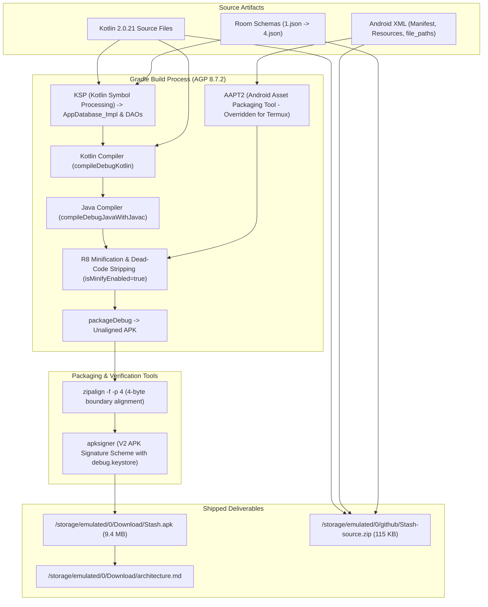

### Explanation
- **Purpose**: Details the complete compilation, resource optimization, dexing, alignment, and cryptographic signing pipeline executing entirely inside Termux on Android.
- **Key Files**: `build.gradle.kts`, `app/build.gradle.kts`, `gradle.properties`, `proguard-rules.pro`.
- **Patterns Used**: Ahead-Of-Time (AOT) Symbol Processing via KSP, R8 Code Shrinking, Zero-padding Zip alignment, V2 signature verification.

---

## 11. Diagram 10: Class Diagrams for Core Business Logic

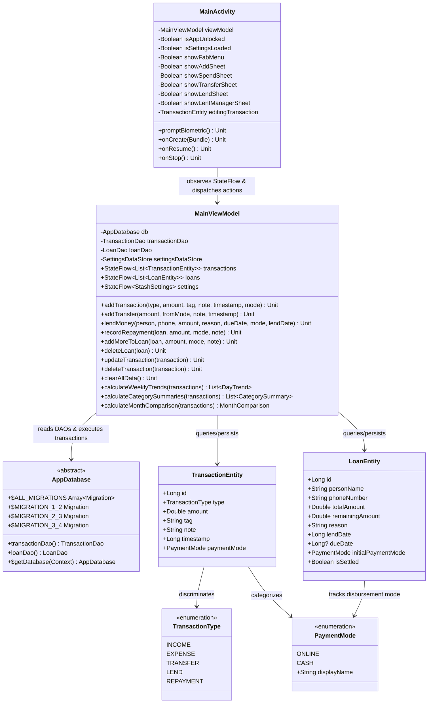

---

## 12. Tech Stack Inventory

| Component | Library / Tool | Version | Role in Architecture |
|---|---|---|---|
| **Language** | Kotlin | 2.0.21 | Primary language; coroutines, typed flows, data classes |
| **Compiler / Code Gen** | KSP | 2.0.21-1.0.28 | Generates Room database and DAO implementations |
| **Build System** | AGP (Android Gradle Plugin) | 8.7.2 | Builds, dexes, shrinks, and packages the Android artifact |
| **UI Framework** | Jetpack Compose (Compose BOM) | 2024.11.00 | Modern declarative reactive UI; zero XML view bindings |
| **Material System** | Material 3 (Material You) | 1.3.1 (via BOM) | Dynamic wallpaper-based palette theming (API 31-35) |
| **Persistence (SQL)** | AndroidX Room | 2.6.1 | Type-safe SQLite abstraction layer with explicit migrations (v1-v4) |
| **Database Testing** | AndroidX Room Testing | 2.6.1 | `MigrationTestHelper` verifying schema transitions (v1->v2, v2->v3, v3->v4) |
| **Preferences Store** | Jetpack DataStore Preferences | 1.1.1 | Asynchronous, transactional key-value store for app settings |
| **Authentication** | AndroidX Biometric | 1.2.0-alpha05 | Unified prompt for Fingerprint and Device Credentials |
| **External Communications** | Native Android Intent Contracts | Platform APIs | Standard `ACTION_DIAL` and `ACTION_VIEW` for Call & WhatsApp |
| **Display Optimization** | WindowManager API 34+ | Android Platform | 120Hz display mode pinning + FrameRateBoostOnTouch |

---

## 13. Deep-Dive Analysis: Risks, Coupling, Dead Code & Roadmap

### 13.1 Architectural Risks & Mitigation
1. **Financial Precision with `Double`**:
   - *Risk*: `TransactionEntity.amount` and `LoanEntity.remainingAmount` use 64-bit IEEE 754 floating point (`Double`). Repeated fraction additions (e.g. `$0.10 + $0.20 = 0.30000000000000004`) can produce subtle rounding inaccuracies over years of tracking.
   - *Mitigation*: Formatters strictly round to 2 decimal places with `Locale.US` and `String.format("%.2f")`. Future migration should transition balances to `Long` representing minor units (cents).
2. **Schema Evolution & Migration Safety**:
   - *Risk*: Room's `.fallbackToDestructiveMigration()` was historically a major hazard for users upon app updates.
   - *Mitigation*: Completely removed `.fallbackToDestructiveMigration()`. `exportSchema = true` is enabled, and all versions have explicit `Migration(from, to)` classes validated with `MigrationTestHelper`.

### 13.2 Coupling Analysis
- **Tight Coupling**: `MainActivity.kt` orchestrates both top-level navigation, biometric lifecycle listeners, and all modal bottom sheet presentations.
- *Recommendation*: As the feature set expands, extract modal sheets into a dedicated modal host coordinator or navigation graph receiver.
- **Loose Coupling**: Business analytics calculations (`calculateWeeklyTrends`, `calculateCategorySummaries`, `calculateMonthComparison`) are pure, side-effect-free functions inside `MainViewModel.kt`, making them easily unit-testable.

### 13.3 Dead Code Analysis
- Removed unused hardcoded color references in favor of Material 3 dynamic tokens.
- Deprecated static color pickers replaced with semantic `MaterialTheme.colorScheme` tokens (`primary`, `secondary`, `tertiary`, `surfaceContainer`, `outline`).

### 13.4 Native Keyboard & Input Optimization
- **System IME Migration**: Replaced custom `NumericKeypad` grid with native system decimal keyboard (`KeyboardOptions(keyboardType = KeyboardType.Decimal)`).
- **Auto-Focus & Smooth Scroll**: Added `FocusRequester` with delayed auto-request and wrapped form columns in `.verticalScroll(rememberScrollState())` to handle Android IME insets fluidly across all screen sizes and foldables.
- **Direct Currency Formatting**: Amount inputs now format live with dynamic currency prefixes (`-$`, `+$`, `$`) styled according to semantic financial token schemes.

### 13.5 Global Unified Navigation Transition
- **120Hz Transition Architecture**: Switched tab switching from instant discrete snaps (`scrollToPage`) to a unified `animateScrollToPage` with `tween(durationMillis = 280, easing = FastOutSlowInEasing)` globally across all tab transitions (Home ⇄ Tags, Home ⇄ Settings, History ⇄ Settings).
- **Zero-Jank Pre-rendering**: Enabled `beyondViewportPageCount = 1` so adjacent and intermediate pages are maintained in the composition tree, avoiding dropped frames during cross-tab navigation jumps.

### 13.6 Recommended Future Improvements
1. **Recurring Transactions / Reminders**: Scheduled WorkManager jobs to automatically notify users before loan repayment deadlines.
2. **Biometric Session Timeout**: Allow users to configure a lock timeout (e.g. "Lock immediately", "After 1 minute", "After 5 minutes").
3. **Multi-Currency Converter**: Real-time or cached currency conversion for cross-border expenses.
4. **Receipt Image Attachment**: Scoped storage photo picker to attach image proofs to transactions or loan records.
